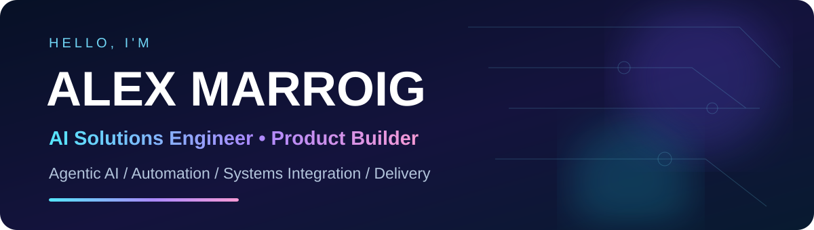

<div align="center">


<br/>

[](https://www.linkedin.com/in/alexmarroig/)
[](https://alex-portfolio-seven-psi.vercel.app/)
[](https://github.com/alexmarroig)

**Building intelligent products and delivering complex enterprise technology.**

</div>

## 👋 About me

I'm **Alex Marroig**, an AI Solutions Engineer and PMP-certified technical delivery professional based in São Paulo, Brazil. I have **10+ years of experience** working across complex technology implementations, enterprise integrations, automation, and cross-functional transformation programs.

At **Inbenta**, I work with enterprise conversational AI, integrations, and AI-powered customer experiences for international clients. Outside my enterprise work, I explore and build full-stack apps, agentic developer tools, privacy-first software, and products designed around real user needs.

💜 **Beyond work:** I'm married, love turning ideas into working software, and enjoy exploring how technology can make everyday life better.

## ✨ Selected work

| Project | What I'm building | Stack / focus |
| --- | --- | --- |
| [🤖 Agentic Dev Studio](https://github.com/alexmarroig/Multiagent) | Experimental AI development studio with planning and execution services; MVP components are still mocked | Next.js · FastAPI · Supabase |
| 🛡️ **ETHOS** *(private)* | Offline-first clinical workflows, local speech transcription and human-reviewed documentation; active development | Electron · React Native · Whisper |
| [🧠 PremiumCRM](https://github.com/alexmarroig/PremiumCRM) | API-first CRM backend with multi-tenancy, webhooks and automation; AI provider currently uses mock logic | FastAPI · PostgreSQL · Docker |
| [🗺️ Best Things to Do](https://github.com/alexmarroig/Besthingstodo) | Personal discovery / experiences application; repository is public, detailed functionality still being documented | Product exploration |
| 📋 **Get It Done / LifeDOIT** *(private)* | Local-first personal planning app with smart task prioritization and mobile experience | React · TypeScript · Firebase |
| 🧘 **M-Timer** *(private)* | Meditation companion with session state, streaks and sync architecture | Expo · React Native · Supabase |
| [💞 Couple Closet](https://github.com/alexmarroig/CoupleCloset) | Backend for couple-oriented discovery, date ideas, quizzes, wishlists and commerce integrations | Node.js · Prisma · PostgreSQL |
| [✨ Código do Destino](https://github.com/alexmarroig/CodigodoDestino) | Astrology/numerology web platform with structured narratives and calculation APIs | Next.js · FastAPI |
| [🚗 AXIS Premium Cars](https://github.com/alexmarroig/Carpremiumsell) | API-first vehicle curation prototype with search, alerts and recommendation services | Python · FastAPI · Redis |
| [🧩 Flowchart Generator](https://github.com/alexmarroig/flowchartgenerator) | Workflow-to-diagram backend with Mermaid generation | Node.js · REST API |
| [🌐 Interactive Portfolio](https://github.com/alexmarroig/alex-portfolio) | Professional website with engineering case studies and interactive components | Next.js · TypeScript |

> Projects have different maturity levels. Public repositories demonstrate technical exploration and implementations; private projects are listed at a high level. A repository is not automatically evidence of a production deployment.

## 🛠️ Engineering toolkit


**Focus areas:** Agentic AI · Enterprise Conversational AI · REST APIs · Webhooks · Automation · Technical Delivery · Product Engineering · Quality Assurance

## 🏢 Professional background

- **Inbenta (2024–present):** Enterprise AI solutions, integrations, implementation and delivery.
- **Smurfit Westrock (2024):** Technology projects, process automation and enterprise applications.
- **NotreDame Intermédica / Hapvida (2024):** IT governance and project management.
- **Previous enterprise programs:** Cross-functional transformation and complex post-merger system migrations, including a project involving 30+ applications and 200+ employees.

**Credentials:** PMP® · Professional Scrum Master I · Six Sigma Green Belt

## 📬 Let's connect

I'm interested in technically challenging opportunities involving **AI solutions, agentic systems, technical delivery, and product engineering**.

[LinkedIn](https://www.linkedin.com/in/alexmarroig/) · [Portfolio](https://alex-portfolio-seven-psi.vercel.app/) · [GitHub](https://github.com/alexmarroig)

<div align="center"><sub>Made with curiosity, engineering discipline, and a lot of coffee ☕</sub></div>


---

<details>
<summary><strong>🧑‍💻 Local portfolio development</strong></summary>

This repository contains the source code for my Next.js portfolio.

```bash
npm install
npm run lint
npm run typecheck
npm run build
npm run dev
```

Project cards are maintained in `src/data/projects.tsx`; stack entries are maintained in `src/data/coreStack.ts`.

</details>
